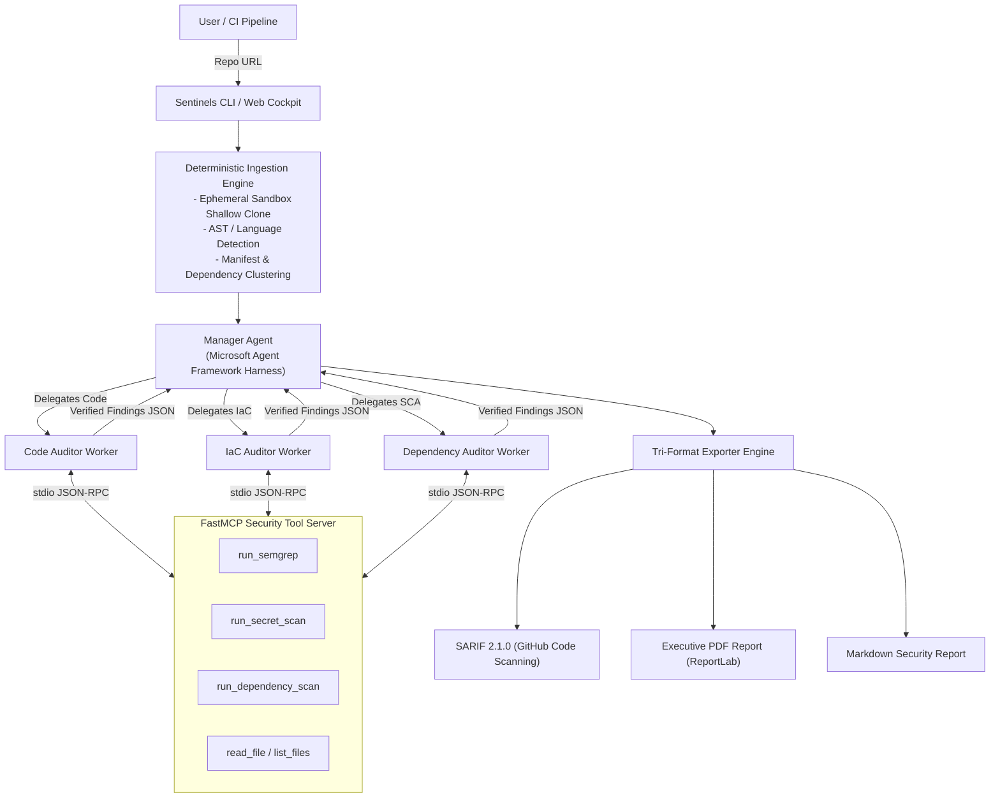

# Sentinels: Autonomous Multi-Agent Security Audit Platform

[](https://python.org)
[](https://github.com/microsoft/agent-framework)
[](https://modelcontextprotocol.io)
[](https://sarifweb.azurewebsites.net)
[](#)

> **Sentinels** is an autonomous, multi-agent cybersecurity intelligence platform engineered to eliminate developer alert fatigue. By combining deterministic static analysis (Semgrep, secret detection, dependency scanning) with contextual LLM reasoning over Microsoft Agent Framework and FastMCP, Sentinels verifies raw findings before reporting them — cutting noise while preserving full recall.

---

## 🚀 Key Highlights

- **Multi-Agent Orchestration:** Powered by **Microsoft Agent Framework** (`agent-framework`), orchestrating a lead Manager Agent and specialized Worker Agents (`CodeAuditor`, `IaCAuditor`, `DependencyAuditor`).
- **Contextual Verification Loop:** Workers read surrounding code and analyze call paths to triage false positives, discarding unexploitable alerts before generating the report.
- **FastMCP Tool Mesh:** Workers interact with local security tools (`run_semgrep`, `run_secret_scan`, `run_dependency_scan`, `read_file`, `list_files`) over standard input/output using the Model Context Protocol (MCP).
- **Tri-Format Enterprise Exporters:** Automatically generates:
  - **SARIF 2.1.0** for direct native ingestion into GitHub Code Scanning and IDE security viewers.
  - **Executive Light-Theme PDF** with severity matrices, vulnerability breakdowns, and unified diff patches.
  - **Technical Markdown Report** ready for pull request comments and security tickets.
- **Developer Cockpit & CLI:** Inspect audits via an interactive terminal CLI (`sentinels`) or launch the real-time glassmorphic Web Cockpit with live SSE streaming (`run_web.py`).
- **Flexible LLM Backends:** Zero-cost local offline execution via **Ollama** (`llama3.2`, `qwen2.5-coder`) or cloud reasoning via **Azure OpenAI** / **OpenAI**.

---

## 🏛️ Architecture



---

## 📦 Directory Structure

```
.
├── src/
│   └── sentinels/
│       ├── agents/              # Microsoft Agent Framework implementations
│       │   ├── manager.py       # Manager agent & delegation tools
│       │   └── workers/         # CodeAuditor, IaCAuditor, DependencyAuditor
│       ├── mcp_server/          # FastMCP tool server
│       │   ├── server.py        # stdio JSON-RPC server
│       │   └── tools/           # semgrep, secrets, dependency scanner, repo tools
│       ├── reporting/           # Report exporters
│       │   ├── markdown_exporter.py
│       │   ├── pdf_exporter.py  # ReportLab PDF generator
│       │   ├── sarif_exporter.py# OASIS SARIF 2.1.0 schema exporter
│       │   └── theme.py         # Visual color palettes & layout metrics
│       ├── schemas/             # Pydantic v2 data models (Finding, Manifest, etc.)
│       ├── web/                 # FastAPI Web Cockpit & static assets
│       │   ├── server.py        # REST & SSE streaming endpoints
│       │   └── static/          # HTML5, modern CSS, dynamic telemetry JS
│       ├── workflow/            # Ingestion & end-to-end orchestration
│       ├── cli.py               # Interactive CLI interface
│       └── config.py            # Multi-provider LLM configuration
├── test_smoke.py                # Fast smoke tests for core functionality
├── test_deep_suite.py           # Exhaustive test suite across 16 security vectors
├── main.py                      # CLI entry shim
├── run_web.py                   # Web Cockpit server launcher
├── Dockerfile                   # Multi-stage production container image
├── docker-compose.yml           # Pre-configured Sentinels + Ollama stack
├── pyproject.toml               # Package specifications & dependencies
└── .env.example                 # Configuration template
```

---

## ⚡ Quick Start

### 1. Prerequisites
- Python 3.10 or higher
- Git installed on your system
- (Optional) Semgrep (`pip install semgrep`)
- (Optional) [Ollama](https://ollama.ai) for local execution, or an Azure / OpenAI API key

### 2. Installation

Clone this repository and set up a virtual environment:

```bash
git clone https://github.com/your-username/sentinels.git
cd sentinels

python3 -m venv .venv
source .venv/bin/activate  # On Windows: .venv\Scripts\activate

pip install -e .
```

### 3. Configuration

Copy the example configuration file and set your desired provider:

```bash
cp .env.example .env
```

Edit `.env`:
```ini
# For local offline execution with Ollama:
LLM_PROVIDER=ollama
OLLAMA_MODEL=llama3.2
OLLAMA_HOST=http://localhost:11434

# Or for Azure OpenAI:
# LLM_PROVIDER=azure
# AZURE_OPENAI_API_KEY=your-key
# AZURE_OPENAI_ENDPOINT=https://your-resource.openai.azure.com/
# AZURE_OPENAI_GPT_DEPLOYMENT=gpt-4o-mini
```

---

## 🖥️ Usage

### Interactive CLI

Scan any public or private Git repository directly:

```bash
# Using the installed command
sentinels https://github.com/pallets/flask

# Or via the dev shim
python main.py https://github.com/pallets/flask
```

Audit reports are automatically saved to the `reports/` directory in SARIF, PDF, and Markdown formats.

### Real-time Web Cockpit

Launch the browser-based dashboard with live SSE streaming:

```bash
python run_web.py
```

Open your browser at `http://127.0.0.1:8000` to trigger scans, inspect agent telemetry, and view findings with remediation patches.

### Docker Deployment

Run Sentinels packaged with an Ollama container:

```bash
docker-compose up -d
docker-compose exec sentinels sentinels https://github.com/pallets/flask
```

---

## 🧪 Testing & Verification

Run the comprehensive test suites to verify integrity across all components:

```bash
# 1. Run core smoke tests
python test_smoke.py

# 2. Run exhaustive test suite (path traversal, symlinks, SARIF validation, schemas)
python test_deep_suite.py
```

---

## 🛡️ Security Guardrails

- **Ephemeral Sandboxing:** Clones repos into isolated temporary folders using HTTPS-only schemes with depth 1.
- **Strict Path Traversal Protection:** All file reading calls verify realpath containment within the sandbox.
- **File Size Caps:** Files larger than 1MB are automatically bypassed to protect LLM context windows and memory.
- **Automatic Cleanup:** Read-only git packfiles and sandbox directories are automatically purged post-audit.

---

## 📄 License

This project is licensed under the MIT License - see the LICENSE file for details.
